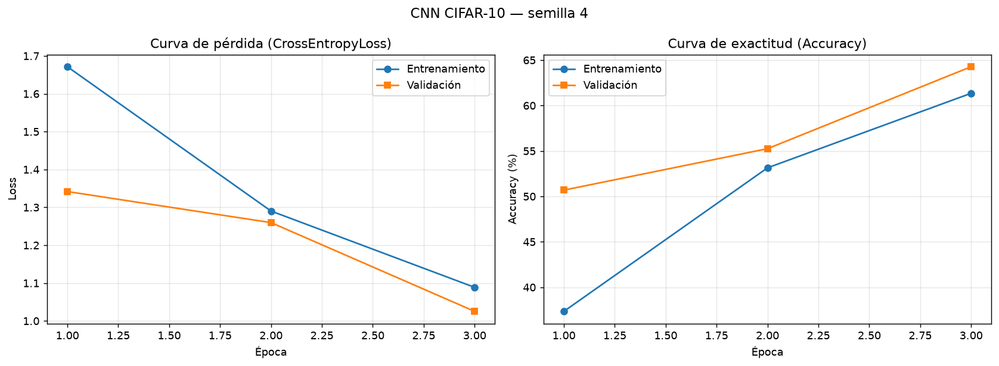
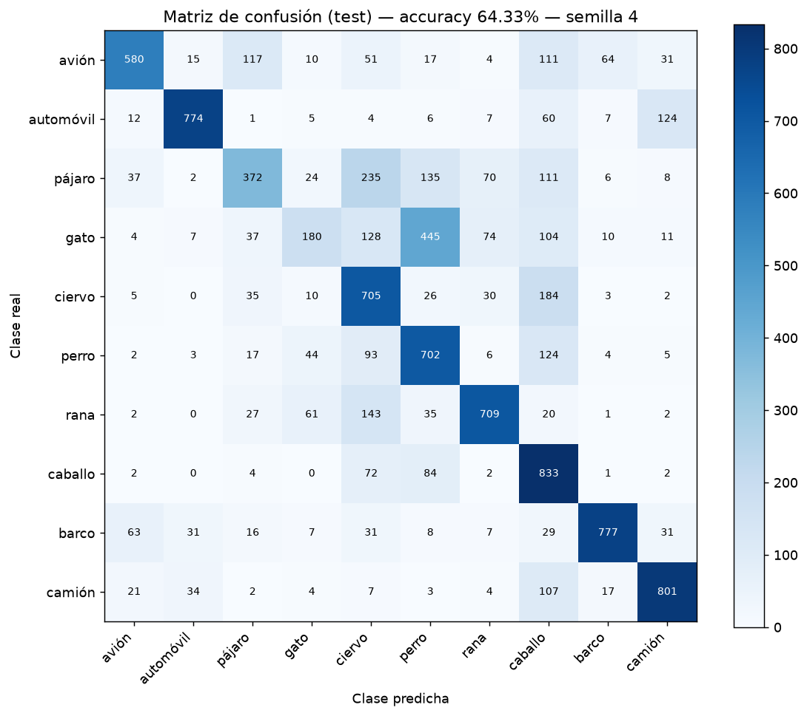

# Clasificación de Imágenes CIFAR-10 con CNN

**Universidad Andina del Cusco — Inteligencia Artificial (SIS070)**
Evaluación de la Segunda Unidad

| Campo | Valor |
|---|---|
| Estudiante | Gonzales Ibañes Angel Erickson |
| Código de matrícula | 022100304G |
| Semilla individual | **4** (`torch.manual_seed(4)`, `np.random.seed(4)`) |

## Estructura

```
├── src/
│   ├── dataset.py      # P1: carga, transformaciones, partición estratificada, visualización
│   ├── model.py        # P3: arquitectura CNN + validación de shapes 4D
│   └── train.py        # P4: entrenamiento (CrossEntropyLoss + Adam) y métricas
├── notebooks/
│   └── experiment.ipynb
├── outputs/
│   ├── loss_accuracy.png
│   └── confusion_matrix.png
├── requirements.txt
└── README.md
```

## Ejecución

```bash
python -m venv .venv
.venv\Scripts\activate          # Windows  (Linux/Mac: source .venv/bin/activate)
pip install -r requirements.txt
python src/dataset.py           # P1: descarga, partición y cuadrícula de muestras
python src/model.py             # P3: validación de shapes
python src/train.py --epochs 20 # P4: entrenamiento y gráficas
```

---

## Pregunta 1 — Preparación de datos

- **Semilla 4** fijada en `random`, `numpy`, `torch` y en el `Generator` del `DataLoader`, por lo que el shuffle, la partición y los pesos iniciales son reproducibles.
- **Transformaciones de entrenamiento:** `RandomCrop(32, padding=4)` → `RandomHorizontalFlip(0.5)` → `ToTensor()` → `Normalize(mean=(0.4914, 0.4822, 0.4465), std=(0.2470, 0.2435, 0.2616))`.
- **Validación y prueba:** solo `ToTensor()` + `Normalize()` (sin aumento, para medir sobre imágenes reales).
- **Partición estratificada** con `train_test_split(stratify=targets, random_state=4)`: 50 000 → **40 000 entrenamiento / 10 000 validación** (4 000 y 1 000 por clase). Prueba independiente: 10 000.

## Pregunta 2 — Justificación: CNN frente a MLP

### ¿Por qué un MLP colapsa o es ineficiente con CIFAR-10?

1. **Explosión de parámetros.** Una imagen de 32×32×3 se aplana en un vector de **3 072** valores. Una sola capa oculta de 1 024 neuronas ya requiere 3 072 × 1 024 ≈ **3,1 millones de pesos**. Con imágenes más grandes (224×224×3 = 150 528 entradas) la cifra se vuelve inmanejable. Muchos parámetros con solo 40 000 ejemplos favorecen el **sobreajuste**.
2. **Pérdida de la estructura espacial.** Al aplanar, el MLP destruye la relación de vecindad entre píxeles: un píxel y su vecino de la derecha son tan "distantes" como dos píxeles de esquinas opuestas. El modelo debe re-aprender desde cero que los píxeles cercanos están correlacionados.
3. **Sin invariancia a la traslación.** Si un gato aparece a la izquierda o a la derecha, para un MLP son patrones completamente distintos que activan pesos diferentes; necesitaría ver el objeto en todas las posiciones posibles.

### ¿Cómo lo resuelven las CNN?

| Propiedad | Efecto |
|---|---|
| **Conexiones locales (campo receptivo)** | Cada neurona mira solo una ventana de 3×3 píxeles, capturando bordes, texturas y esquinas. Las capas profundas combinan estos patrones en formas cada vez más complejas (jerarquía de características). |
| **Weight Sharing (pesos compartidos)** | El mismo filtro se desliza por toda la imagen. Una Conv2d de 3→32 canales con kernel 3×3 tiene solo 3·3·3·32 + 32 = **896 parámetros**, frente a millones en una capa densa. |
| **Equivariancia / invariancia espacial** | Como el filtro es el mismo en todas las posiciones, detecta un patrón donde sea que aparezca; el `MaxPool2d` añade además tolerancia a pequeños desplazamientos. |
| **Reducción progresiva de dimensión** | El pooling reduce H×W a la mitad en cada bloque, por lo que la capa densa final recibe un vector compacto de características (2 048) en vez de píxeles crudos. |

Resultado: la CNN usa **~0,82 M parámetros** y supera ampliamente a un MLP de tamaño comparable (que en CIFAR-10 suele quedarse alrededor de 50–55 % de accuracy).

## Arquitectura de la CNN

| # | Capa | Configuración | Shape de salida |
|---|---|---|---|
| 0 | Entrada | — | (B, 3, 32, 32) |
| 1 | **Bloque 1** | Conv2d(3→32, k3, p1) · BN · ReLU · Conv2d(32→32) · BN · ReLU · **MaxPool2d(2)** | (B, 32, 16, 16) |
| 2 | **Bloque 2** | Conv2d(32→64, k3, p1) · BN · ReLU · Conv2d(64→64) · BN · ReLU · **MaxPool2d(2)** | (B, 64, 8, 8) |
| 3 | **Bloque 3** | Conv2d(64→128, k3, p1) · BN · ReLU · Conv2d(128→128) · BN · ReLU · **MaxPool2d(2)** | (B, 128, 4, 4) |
| 4 | Flatten | 128 × 4 × 4 | (B, 2048) |
| 5 | Dropout(0.5) + **Linear** + ReLU | 2048 → 256 | (B, 256) |
| 6 | Dropout(0.5) + **Linear** | 256 → 10 | (B, 10) logits |

```
(B,3,32,32) ─[Bloque1]→ (B,32,16,16) ─[Bloque2]→ (B,64,8,8) ─[Bloque3]→ (B,128,4,4)
            ─[Flatten]→ (B,2048) ─[Linear]→ (B,256) ─[Linear]→ (B,10)
```

Con `padding=1` y kernel 3×3, la Conv2d conserva H×W: `H_out = (H + 2·1 − 3)/1 + 1 = H`. Solo el MaxPool2d(2) divide entre 2: 32 → 16 → 8 → 4. El tamaño de entrada a la primera capa `Linear` se calcula dinámicamente en `_get_flat_features()` para evitar errores de *Shape Mismatch*.

## Pregunta 3 — Validación del forward pass

`python src/model.py` pasa un batch simulado `torch.randn(8, 3, 32, 32)`, imprime los shapes intermedios y verifica con `assert` que la salida sea `(8, 10)`.

## Pregunta 4 — Entrenamiento y análisis crítico

**Configuración:** `CrossEntropyLoss`, `Adam(lr=1e-3, weight_decay=1e-4)`, batch 128, 20 épocas, semilla 4. Se guarda el modelo con mejor accuracy de validación y se evalúa sobre el test.




### Resultados con semilla 4

> ⚠️ Completar con los valores que imprime `train.py` (también quedan en `outputs/metrics.json`).

| Métrica | Valor |
|---|---|
| Accuracy entrenamiento (última época) | XX.XX % |
| Accuracy validación (última época) | XX.XX % |
| Mejor accuracy validación | XX.XX % |
| Loss entrenamiento / validación (última época) | X.XXXX / X.XXXX |
| **Accuracy en test** | **XX.XX %** |
| Brecha train − val | ±X.XX pp |

### Interpretación

Criterios usados:
- **Overfitting:** accuracy de train muy superior a validación (brecha > ~8–10 pp) y loss de validación que sube mientras la de train sigue bajando.
- **Underfitting:** accuracy baja en ambos conjuntos (< ~60 %) con curvas aún en ascenso o estancadas en valores bajos.
- **Buen ajuste:** curvas paralelas y cercanas, loss de validación estable.

*(Redactar con tus números, por ejemplo:)* Con la semilla 4, el modelo alcanzó XX % en entrenamiento y XX % en validación, una brecha de X pp. Como la loss de validación [se mantuvo estable / empezó a subir desde la época N], el modelo [no presenta sobreajuste significativo / presenta un sobreajuste leve]. Es común que la accuracy de validación sea **igual o mayor** que la de entrenamiento en las primeras épocas, porque el entrenamiento se mide sobre imágenes con *data augmentation* y Dropout activo, mientras que la validación usa imágenes limpias y el modelo en modo `eval()`.

En la matriz de confusión, las clases con más errores suelen ser **gato ↔ perro** y **automóvil ↔ camión** (formas y texturas parecidas a 32×32), mientras que **automóvil, barco y rana** suelen superar el 85 %. *(Confirmar con tu matriz.)*

**Mejoras posibles:** más épocas con `ReduceLROnPlateau`/`CosineAnnealingLR`, más aumento de datos (`ColorJitter`, `RandomRotation`), o una arquitectura más profunda (tipo ResNet).
